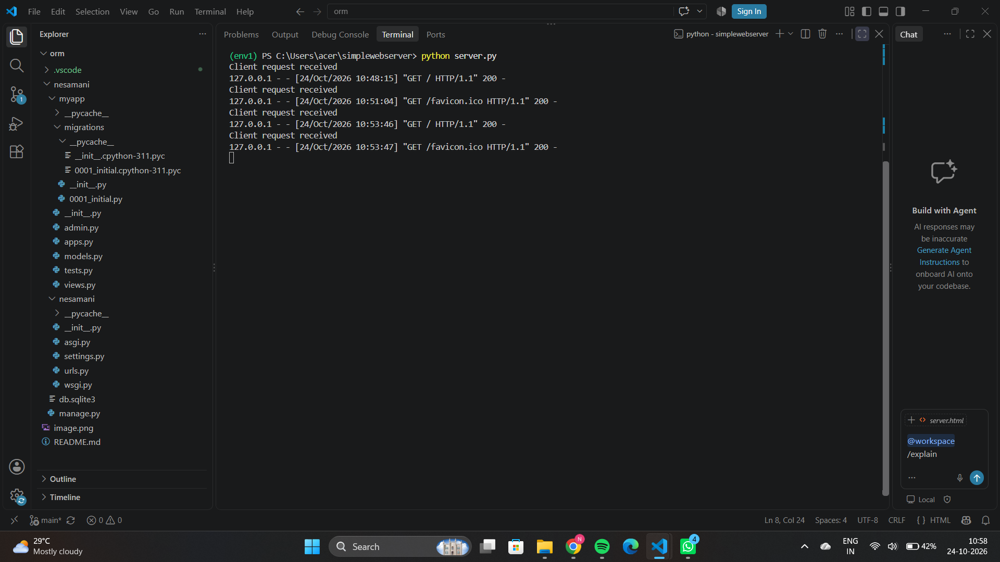

# EX01 Developing a Simple Webserver
## Date: 28.09.2026
    `
## AIM:
To develop a simple webserver to serve html pages and display the Windows Specifications of your Laptop.

## DESIGN STEPS:
### Step 1: 
HTML content creation.

### Step 2:
Design of webserver workflow.

### Step 3:
Implementation using Python code.

### Step 4:
Import the necessary modules.

### Step 5:
Define a custom request handler.

### Step 6:
Start an HTTP server on a specific port.

### Step 7:
Run the Python script to serve web pages.

### Step 8:
Serve the HTML pages.

### Step 9:
Start the server script and check for errors.

### Step 10:
Open a browser and navigate to http://127.0.0.1:8000 (or the assigned port).

## PROGRAM:
```
from http.server import HTTPServer, BaseHTTPRequestHandler
content = """
<html>
      
    <head>
        <title>rise of table</title>
    </head>
    <body bgcolor="pink">
        <h2 align="center">name: nethaji samaran</h2>
        <h2 align="center">
            ref_no: 26015547
        </h2>
        <caption align="center">pc props</caption>
        <Table border="5" bgcolor="grey" cellspacing="1" cellpadding="5" >
            <tr>
                <th>S.no</th>
                <th>device_type</td>	
                <td>device_info</td>
            </tr>
            <tr>
                <th>1</th>
                <th>Device name</th>	
                <td>dates</td>
            </tr>


            <tr>
                <th>2</th>
                <th>processor</td>
                <td>Intel(R) Core(TM) 5 210H (2.20 GHz)</td></tr>
            <tr>
                <th>3</th>
                <th>Installed RAM</td>
            <td>6.0 GB (15.7 GB usable)</td></tr>
            <tr>
                <th>4</th>
                <th>
                    graphics card
                </th>
                <td>
                    Intel(R) Graphics (128 MB)
                </td>
            </tr>
            <tr>
                <th>5</th>
                <th>Storage</td>
                <td>130 GB of 477 GB used</td>

            </tr>
            <tr>
                <th>6</th>
                <th>Device ID</td>
                <td>84C51027-8EF4-459F-B8AB-12B995C917A6</td>
            </tr>
            <tr>
                <th>7</th>
                <th>Product ID</td>
                <td>jijjjjiojhi8jjhuc</td>

            </tr>
            
            <tr>
                <th>8</th>
                <th>system id</td>
            <td>64_bit os</td>
            </tr>

        </Table>
    </body>
 
</html>
"""
class myhandler(BaseHTTPRequestHandler):
    def do_GET(self):
        print("Client request received")
        self.send_response(200)
        self.send_header('content-type', 'text/html; charset=utf-8')
        self.end_headers()
        self.wfile.write(content.encode())
server_address = ('',8000)
httpd = HTTPServer(server_address,myhandler)
print("my own webserver is running successfully...")
httpd.serve_forever()
```

## OUTPUT:
Webpage


Server page




## RESULT:
The program for implementing simple webserver is executed successfully.
